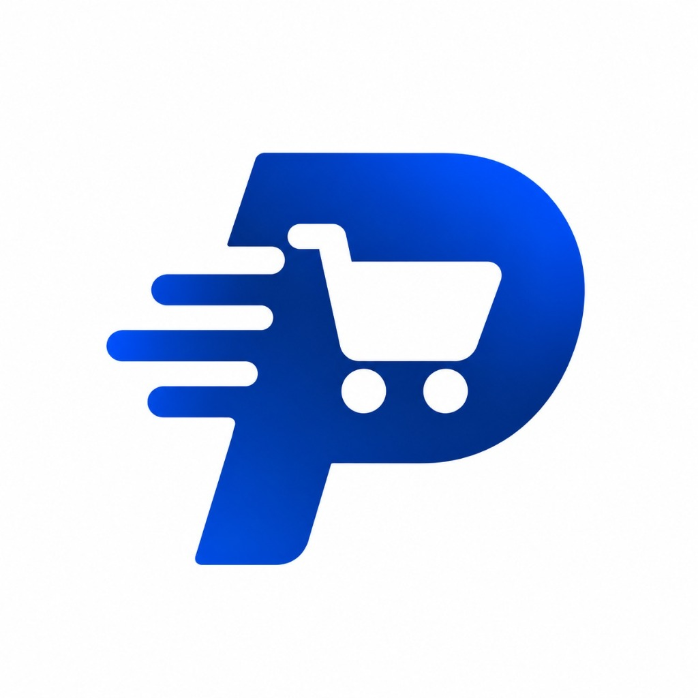

<div align="center">
  
  <h1>ProcurePilot AI</h1>
  <p><strong>Autonomous Wholesale Purchasing Agent with PayPal Global Settlement</strong></p>
  <p><em>Engineered for the PayPal Hackathon</em> — Translates natural-language restock requests into mathematically optimized purchase orders fulfilled by regional wholesale distributors and settled securely worldwide via PayPal Orders v2 Sandbox.</p>

[](https://developer.paypal.com/)
[](https://developer.paypal.com/)
[](https://ai.google.dev/)
[](https://www.typescriptlang.org/)
[](https://nodejs.org/)
[](https://reactjs.org/)
[](https://vitejs.dev/)
[](https://tailwindcss.com/)
[]()
</div>

---

## Table of Contents
1. [🏆 PayPal Hackathon Feature Spotlight: Global Settlement & Sandbox Architecture](#1--paypal-hackathon-feature-spotlight-global-settlement--sandbox-architecture)
2. [Product Overview & Agent Architecture](#2-product-overview--agent-architecture)
3. [📱 Mobile Companion App & Android APK Distribution](#3-mobile-companion-app--android-apk-distribution)
4. [Non-Negotiable Safety & Financial Guardrails](#4-non-negotiable-safety--financial-guardrails)
5. [Dual-Currency Engine: INR Paise to USD Cents](#5-dual-currency-engine-inr-paise-to-usd-cents)
6. [Repository Structure](#6-repository-structure)
7. [How to Run (Local, LAN, & Internet)](#7-how-to-run-local-lan--internet)
   - [Prerequisites](#prerequisites)
   - [Option A: 1-Click Quickstart (Embedded DB, Zero Config)](#option-a-1-click-quickstart-embedded-db-zero-config)
   - [Option B: Production Configuration (MongoDB Atlas, Gemini 3.5, PayPal)](#option-b-production-configuration)
   - [Worldwide Access via Secure Tunnel (ngrok / Cloudflare)](#worldwide-access-via-secure-tunnel-ngrok--cloudflare)
8. [Hackathon Judge Quick-Start & Live Evaluation Script](#8-hackathon-judge-quick-start--live-evaluation-script)
9. [Testing & Quality Verification](#9-testing--quality-verification)
10. [Environment Variables Reference](#10-environment-variables-reference)
11. [Teammates Roadmap: What's Done & What to Do](#11-teammates-roadmap-whats-done--what-to-do)
    - [📱 Flutter Mobile Companion App](#-flutter-mobile-developer-guide)
    - [🤖 AI / ML & Vernacular Prompt Engineer](#-ai--ml--vernacular-prompt-engineer)
    - [💳 Payments & Global Settlement Engineer](#-payments--domestic-settlement-engineer)
    - [🚚 Supplier Dispatch & Logistics Lead](#-supplier-dispatch--logistics-lead)
    - [☁️ DevOps & Cloud Deployment Lead](#-devops--cloud-deployment-lead)
12. [Documentation & API Reference](#12-documentation--api-reference)
13. [License](#13-license)

---

## 1. 🏆 PayPal Hackathon Feature Spotlight: Global Settlement & Sandbox Architecture

ProcurePilot bridges the gap between regional brick-and-mortar commerce (small supermarkets, kirana grocery stores, cafes, and branch franchises) and **PayPal's global payments network**. Wholesale inventory is sourced locally, while payment settlement is executed internationally with full regulatory and currency compliance.

```
┌──────────────────────────────────────────────────────────────────────────────────────────────────┐
│                                 PROCUREPILOT GLOBAL PAYPAL PIPELINE                              │
├──────────────────────────┬───────────────────────────────────────┬───────────────────────────────┤
│ 1. LOCAL CATALOGUE (INR) │ 2. FX INTEGER ENGINE (INR ➔ USD)     │ 3. PAYPAL SANDBOX SETTLEMENT  │
│ • 38 FMCG Stock Items    │ • Rate: DEMO_INR_PER_USD (e.g., ₹88)   │ • PayPal Orders v2 REST API   │
│ • 7 Wholesale Vendors    │ • Formula: ⌈INR_Paise / (Rate*100)⌉    │ • Intent: CAPTURE             │
│ • MOQ & Tiered Discounts │ • Zero floating-point rounding errors  │ • Webhook SHA256 Signature    │
│ • Base currency: Paise   │ • Full itemized cart disclosure in USD │ • 1-Click Sandbox Bypass Mode │
└──────────────────────────┴───────────────────────────────────────┴───────────────────────────────┘
```

### Key PayPal Integrations:
1. **PayPal Orders v2 Server-Side Creation (`POST /v2/checkout/orders`)**:
   - Authorized via OAuth 2.0 Bearer tokens generated from PayPal Sandbox Client ID & Secret.
   - Enforces `intent: 'CAPTURE'`.
   - Transmits complete itemized purchase units with line-item breakdowns in USD cents.
   - Returns explicit HATEOAS `'approve'` URLs alongside custom redirect return URLs (`/orders/:id/payment-result`).
2. **Deterministic Cryptographic Capture (`POST /v2/checkout/orders/{id}/capture`)**:
   - The backend *never* trusts client-side authorization callbacks alone.
   - On approval, the backend communicates directly with PayPal's API to capture the exact authorized amount.
   - Verifies the captured amount in cents against the purchase order record in MongoDB before advancing the order state to `PAID`.
3. **Cryptographic Webhook Signature Verification (`POST /v1/notifications/verify-webhook-signature`)**:
   - Full webhook listener verifying `CHECKOUT.ORDER.APPROVED` and `PAYMENT.CAPTURE.COMPLETED`.
   - Verifies certificate chain URLs (`api.sandbox.paypal.com`), transmission IDs, timestamps, and `SHA256withRSA` signature hashes to prevent replay or spoofing attacks.
4. **Dual Evaluation Workflow for Hackathon Reviewers**:
   - **Mode 1 (Standard PayPal Sandbox)**: Judges can authenticate with any PayPal Sandbox buyer account via the official `<PayPalButtons />` SDK component.
   - **Mode 2 (1-Click Instant Evaluation Sandbox)**: To prevent judges from getting stuck on sandbox login loops or browser pop-up blockers, our checkout provides an instant **"1-Click Sandbox Checkout (Judge Bypass)"** button that simulates the complete server capture and triggers sub-supplier allocations instantly.

---

## 2. Product Overview & Agent Architecture

Small retail store owners spend over 12 hours a week manually tallying stock, deciphering handwritten chits, negotiating on WhatsApp distributor channels, and calculating complex volume thresholds.

ProcurePilot AI automates this entire lifecycle end-to-end:

```
[Store Owner Natural Language Request]
         │  (Text / Audio: "Restock 20 cooking oil, 30 rice, 15 detergent under ₹15,000")
         ▼
[Google Gemini 2.5 / 3.5 Flash AI] ──► Validated Structured JSON (quantities, units, budget)
         │
         ▼
[Wholesale Product Catalogue] ────────► 38 fast-moving SKUs & 7 regional distributors
         │
         ▼
[Knapsack DP Optimizer Engine] ───────► Mathematically optimal basket (Balanced / Cheapest / Reliable / Fastest)
         │
         ▼
[Gemini Explanation Generator] ───────► Plain-language business justification of trade-offs
         │
         ▼
[Mandatory Owner Review & Approval] ──► State machine gatekeeper (DRAFT ➔ APPROVED)
         │
         ▼
[PayPal Orders v2 Global Checkout] ──► Transparent INR-to-USD conversion, capture, webhook verification
         │
         ▼
[Supplier Sub-Order Split & Analytics] ─► Visual Spend Intelligence (Dark/Light Recharts)
```

---

## 3. 📱 Mobile Companion App & Android APK Distribution

ProcurePilot ships with a native-style **Mobile Companion Experience** specifically engineered for retail kirana proprietors and supermarket stock managers who run inventory checks directly from their store aisles.

```
┌────────────────────────────────────────────────────────────────────────────────────────┐
│                        PROCUREPILOT MOBILE COMPANION ARCHITECTURE                      │
├──────────────────────────┬─────────────────────────────┬───────────────────────────────┤
│ 1. FLOOR CAPTURE         │ 2. EDGE AI RESTOCKING       │ 3. GLOBAL SANDBOX SETTLEMENT  │
│ • Vernacular Voice Chits │ • Offline SKU Matching      │ • Biometric 1-Tap Sign-Off    │
│ • GTIN-13 Shelf Barcodes │ • 0/1 Knapsack Allocations  │ • PayPal Orders v2 Sandbox    │
│ • Instant Item Parsing   │ • Dynamic Margin Tickers    │ • Local Sub-Line Push Alerts  │
└──────────────────────────┴─────────────────────────────┴───────────────────────────────┘
```

### Key Mobile Companion Features:
1. **Interactive APK Download Widget (`AppDownloadWidget`)**:
   - Integrated into both the **Landing Page** (`#mobile-app`) and the **Merchant Command Dashboard**.
   - Displays real-time download metadata: Package size (~24 MB), Android version target (Android 9.0+), architecture (`ARM64` / Universal), and SHA-256 verification status.
2. **On-Screen High-Contrast Camera QR Scanner**:
   - Store owners can click **Scan QR** on the desktop web app to open an instantaneous, high-contrast SVG QR code modal.
   - Scan directly with any phone camera to trigger the APK package download without needing to connect cords or transfer files manually.
3. **Vernacular Speech-to-Chit Dictation**:
   - Proprietors speak naturally in Hindi, Hinglish, or regional dialects (e.g., *"20 tel, 30 basmati chawal under pandrah hazaar"*).
   - Google Gemini parses requirements into structured SKUs, units, and hard price caps on the fly.
4. **GTIN-13 Packaging Barcode Scanner**:
   - Direct camera-based barcode scanning instantly queries the backend catalog of 38 fast-moving SKUs and fetches real-time wholesale distributor tier quotes.
5. **Real-Time Push Alerts for Multi-Supplier Split Shipments**:
   - Instant notifications as local distributors in Mumbai accept, pack, and dispatch sub-order lines.

#### 4-Step Android Installation Guide:
```
[1. Scan QR / Click Download] ➔ [2. Select "Download Anyway"] ➔ [3. Allow Browser Install] ➔ [4. Sign In & Procure]
```
*Configurable via `VITE_APK_DOWNLOAD_URL` in `frontend/.env`.*

---

## 4. Non-Negotiable Safety & Financial Guardrails

1. **Zero AI Financial Authority**: AI models *never* compute authoritative pricing, select winning suppliers independently, or mark orders paid. AI is strictly constrained to (a) extracting structured JSON requirements from prose and (b) generating human-readable explanations. All monetary arithmetic, supplier matching, and state transitions are executed by deterministic TypeScript code.
2. **Integer Paise & Cent Precision**: All money in the database and API payloads is stored as integer `paise` (INR) and integer `cents` (USD). Floating-point math is strictly forbidden (`utils/money.ts`).
3. **Never Trust Frontend Totals**: The backend recalculates item line prices, distributor volume tiers, delivery charges, and final totals from database records at order creation, payment creation, and payment capture.
4. **Enforced State Machine**: PayPal sandbox payment orders cannot be created until the store owner explicitly checks the verification checkbox and signs off on the purchase order (`DRAFT` $\to$ `PENDING_APPROVAL` $\to$ `APPROVED` $\to$ `PAYMENT_PENDING` $\to$ `PAID`).
5. **Multi-Vendor Partitioning**: A single checkout cannot split payments across independent supplier bank accounts. The merchant account receives payment once, and the system partitions the order into supplier fulfillment sub-lines.
6. **Transparent Currency Disclosure**: Clear breakdown of local currency (INR) and PayPal settlement currency (USD) displayed before approval and at checkout.

---

## 5. Dual-Currency Engine: INR Paise to USD Cents

Because regional distributors operate locally in Indian Rupees while PayPal Sandbox operates internationally in USD, ProcurePilot uses an integer-safe currency conversion service (`services/currency/`):

$$\text{USD Cents} = \left\lceil \frac{\text{INR Paise}}{\text{DEMO\_INR\_PER\_USD} \times 100} \times 100 \right\rceil$$

### Conversion Examples:

| Item Line | Local Wholesale (INR) | Converted Total (USD at ₹88/USD) | Exact Cent Amount |
|---|---|---|---|
| 20x Fortune Sunlite Oil (1L) | ₹2,700.00 (270,000 paise) | $30.69 | `3069 cents` |
| 30x India Gate Basmati (1kg) | ₹4,950.00 (495,000 paise) | $56.25 | `5625 cents` |
| 15x Surf Excel Detergent (1kg)| ₹2,070.00 (207,000 paise) | $23.53 | `2353 cents` |
| **Consolidated PO Total** | **₹9,720.00 (972,000 paise)** | **$110.46** | **`11046 cents`** |

*Both the INR total and the USD settlement amount are visibly cross-referenced on the purchase order, checkout receipt, and PayPal transaction metadata.*

---

## 6. Repository Structure

```
procurepilot-ai/
├── docs/                      # Architectural, API, & PayPal Specifications
│   ├── assets/                # High-res logos and diagram assets
│   │   └── logo.png           # Official ProcurePilot Logo
│   ├── architecture.md        # Mermaid diagrams, ER schema, knapsack algorithm details
│   ├── api-documentation.md   # Complete REST endpoint specifications with curl commands
│   ├── payment-flow.md        # Sequence diagrams for PayPal sandbox & webhook verification
│   ├── openapi.yaml           # OpenAPI 3.0 specification for Flutter mobile client
│   └── postman/               # Ready-to-import Postman collection with token capture
│
├── backend/                   # Node.js + Express + TypeScript REST API
│   ├── src/
│   │   ├── config/            # Zod-validated env, MongoDB/In-Memory connection, logger
│   │   ├── models/            # Mongoose models (User, Business, Product, Supplier, Offer, Order, Payment)
│   │   ├── modules/
│   │   │   ├── auth/          # Authentication & Profile management (PATCH /api/auth/profile)
│   │   │   ├── products/      # Catalog browsing, filtering, search
│   │   │   ├── suppliers/     # Supplier directories, reliability scores, and offers
│   │   │   ├── procurement/   # Analyze (Gemini), Search, Optimize (Knapsack DP)
│   │   │   ├── orders/        # Purchase Order state machine, lifecycle, approval
│   │   │   ├── payments/      # PayPal Orders v2 create, capture, webhook listener
│   │   │   └── analytics/     # Spend analytics, category distribution, budget utilization
│   │   ├── services/
│   │   │   ├── ai/            # Gemini SDK client, prompt templates, regex fallback parser
│   │   │   ├── matching/      # Product alias & token similarity search
│   │   │   ├── optimizer/     # Multiple-choice 0/1 knapsack dynamic programming
│   │   │   ├── paypal/        # PayPal Orders v2 REST client & cryptographic webhook verifier
│   │   │   └── currency/      # Fixed demo INR-to-USD conversion service
│   │   ├── middleware/        # JWT auth, Zod validation, error handling, rate limiting
│   │   ├── utils/             # Integer money helpers, ApiError, async handler
│   │   ├── seed/              # Seed data: 38 products, 7 distributors, 210 offers, demo account
│   │   ├── app.ts             # Express application factory
│   │   └── server.ts          # Server entrypoint with auto-seeding on fresh database
│   ├── tests/                 # 10 test suites covering all units and integration paths (43 passing)
│   └── package.json
│
├── frontend/                  # React 18 + Vite + Tailwind CSS v4 Single Page Application
│   ├── public/
│   │   └── logo.png           # High-resolution brand logo
│   ├── src/
│   │   ├── api/               # Axios API clients with TanStack Query integration
│   │   ├── components/
│   │   │   ├── procurement/   # CommandBar, AgentTimeline, BudgetMeter, SupplierMatrix
│   │   │   ├── orders/        # StatusBadge, StatusTimeline, ApprovalPanel, SupplierGroupCard
│   │   │   ├── payments/      # FxNotice, PayPalCheckout, PaymentStatusCard
│   │   │   ├── charts/        # Theme-aware SpendChart & SupplierShareChart with distinct palette
│   │   │   ├── layout/        # AppShell, Sidebar, TopBar, MobileNav, ThemeToggle
│   │   │   └── ui/            # Button, Input, Badge, Dialog, Skeleton, Textarea
│   │   ├── pages/             # Landing, Login, Register, Dashboard, Procure, Orders, Settings, Analytics
│   │   ├── store/             # Zustand auth store & theme store with localStorage persistence
│   │   ├── router.tsx         # BrowserRouter with ProtectedRoute guards
│   │   └── main.tsx           # Entrypoint with smooth scrolling
│   ├── vite.config.ts         # Vite config with 0.0.0.0 binding and /api proxy
│   └── package.json
│
├── mobile/                    # Reserved for Flutter mobile companion app (see mobile/README.md)
│   └── README.md
│
├── render.yaml                # Render blueprint for cloud backend deployment
├── vercel.json                # Vercel SPA rewrites configuration
└── README.md                  # This file
```

---

## 7. How to Run (Local, LAN, & Internet)

### Prerequisites
- **Node.js**: v20.x or higher (`node -v`)
- **npm**: v10.x or higher (`npm -v`)
- **Git**: Installed and configured

---

### Option A: 1-Click Quickstart (Embedded DB, Zero Config)

ProcurePilot is designed to run immediately with **zero external dependencies**. If no MongoDB URI is supplied, the backend boots an embedded in-memory `MongoMemoryServer` and automatically seeds 38 FMCG products, 7 distributors, 210 offers, and the demo account.

#### Step 1: Start Backend
```bash
cd backend
cp .env.example .env
npm install
npm run dev
```
*Backend starts on `http://localhost:5000` (or `5001`) and logs:*
```
[INFO] Upserting catalog products... Saved 38 products.
[INFO] Generated and indexed 210 supplier offers.
[INFO] Demo account created: demo@procurepilot.ai / Demo@12345
[INFO] 🚀 ProcurePilot API server listening on port 5001
```

#### Step 2: Start Frontend
In a second terminal:
```bash
cd frontend
cp .env.example .env
npm install
npm run dev
```
*Frontend starts on `http://localhost:5173` with instant proxy to the backend.*

---

### Option B: Production Configuration

To connect real cloud services:
1. **MongoDB Atlas**: Set `MONGODB_URI=mongodb+srv://...` in `backend/.env`.
2. **Google Gemini AI**: Set `GEMINI_API_KEY=AQ...` in `backend/.env` for live Google Gemini 2.5/3.5 Flash inference. (If left blank, the built-in regex fallback parser operates seamlessly).
3. **PayPal Sandbox**: Set `PAYPAL_CLIENT_ID` and `PAYPAL_CLIENT_SECRET` in `backend/.env`, and `VITE_PAYPAL_CLIENT_ID` in `frontend/.env`.

---

### Worldwide Access via Secure Tunnel (ngrok / Cloudflare)

To let hackathon teammates or judges test the live app without local setup, expose the frontend port:

#### Using Cloudflare Tunnels (No account needed):
```bash
npx --yes cloudflared tunnel --url http://localhost:5173
```
*Gives an instant public URL: `https://xxxx.trycloudflare.com`.*

---

## 8. Hackathon Judge Quick-Start & Live Evaluation Script

Follow this step-by-step walkthrough to evaluate the entire autonomous procurement & PayPal settlement pipeline:

### 1. Instant Sign In
1. Open `http://localhost:5173` (or the public tunnel URL).
2. Click **Log In** $\to$ click the **"Use 1-Click Demo Account"** button (pre-loads `demo@procurepilot.ai` with pre-configured store profile).

### 2. Autonomous Natural-Language Sourcing
1. Navigate to **Procure** (`/procure`).
2. Type or paste the prompt:
   > *"I need 20 units of cooking oil, 30 packets of rice, and 15 units of detergent. Keep the total under ₹15,000. Prioritize reliable suppliers."*
3. Click **Run Autonomous Sourcing**.
4. Observe the 4-stage pipeline:
   - **Step 1 (Parse)**: Structured JSON requirements extracted via Gemini (quantities, units, ₹15,000 ceiling).
   - **Step 2 (Catalogue Match)**: Matches against Fortune Oil, India Gate Basmati, and Surf Excel.
   - **Step 3 (Knapsack Optimization)**: Pure mathematical solver optimizes vendor allocation.
   - **Step 4 (Plain Language Plan)**: Gemini explains supplier trade-offs and delivery schedules.

### 3. Trade-off Strategy Switching
- Click between **Balanced**, **Cheapest**, **Reliable**, and **Fastest** tabs. Notice the allocation, lead times, and totals adapt dynamically.

### 4. PO Creation & State Machine Review
1. Click **Add to Cart & Review** $\to$ inspect vendor fulfillment groups.
2. Click **Create Purchase Order** $\to$ redirected to order detail page (Status: `PENDING_APPROVAL`).
3. Notice that PayPal Checkout is strictly locked until owner approval.
4. Check *"I verify the items, quantities, and supplier terms"* $\to$ click **Approve Purchase Order** (Status: `APPROVED`).

### 5. PayPal Sandbox Checkout (International Settlement)
1. Click **Proceed to PayPal Checkout** (`/orders/:id/checkout`).
2. Notice the dual-currency disclosure:
   > *"Demo conversion: ₹X ≈ $Y at ₹88/USD (sandbox only)"*
3. **Choose your evaluation route**:
   - **Route A**: Click the official PayPal button and sign in with any PayPal Sandbox buyer account.
   - **Route B (1-Click Judge Bypass)**: Click **"Instant Sandbox Checkout (1-Click Capture)"** to immediately simulate server capture.
4. Order transitions to `PAID` with verified PayPal Transaction ID, server capture confirmation, and cryptographic webhook verification indicator.

### 6. Spend Intelligence & Dynamic Analytics
1. Navigate to **Analytics** (`/analytics`).
2. Notice the **Monthly Spend Trend** and **Supplier Spend Share** charts.
3. Toggle between Dark Mode and Light Mode using the sun/moon toggle in the top bar:
   - Notice how all axes, gridlines, and tooltips adjust with high contrast.
   - Distinct, vibrant colors are used exclusively for orders and suppliers, while maintaining a sleek monochrome design across the rest of the application.

### 7. Profile & Business Settings Persistence
1. Navigate to **Settings** (`/settings`).
2. Update the store name, category, owner name, city, or monthly budget.
3. Click **Save Settings** $\to$ changes persist directly to MongoDB (`PATCH /api/auth/profile`).

---

## 9. Testing & Quality Verification

### Run Backend Unit & Integration Tests (43 tests)
```bash
cd backend
npm run test
```

The test suite validates:
- Integer money arithmetic (paise $\leftrightarrow$ rupees, cents $\leftrightarrow$ dollars, safe rounding)
- Token-based JWT authentication and refresh token rotation
- Multi-tenant business isolation
- Regex fallback parser for Hinglish natural-language prompts
- Product catalog token & synonym matching
- Multiple-choice knapsack DP optimization algorithm under diverse budget constraints
- Purchase order finite state machine transitions
- PayPal Orders v2 capture verification and webhook cryptographic signature validation

### Run Production Build
```bash
# Verify backend build
cd backend
npm run build

# Verify frontend build
cd frontend
npm run build
```

---

## 10. Environment Variables Reference

### Backend (`backend/.env`)

| Variable | Required | Default | Description |
|---|---|---|---|
| `PORT` | No | `5000` | HTTP port for the Express backend |
| `NODE_ENV` | No | `development` | `development`, `test`, or `production` |
| `MONGODB_URI` | No | *(In-Memory)* | MongoDB connection URI. If omitted, uses embedded `MongoMemoryServer` |
| `CORS_ORIGINS` | No | `http://localhost:5173` | Comma-separated list of allowed origins |
| `JWT_ACCESS_SECRET` | Yes | — | Secret string for signing access tokens ($\ge 32$ chars) |
| `JWT_REFRESH_SECRET`| Yes | — | Secret string for signing refresh tokens ($\ge 32$ chars) |
| `JWT_ACCESS_EXPIRES_IN` | No | `1h` | Expiration time for access tokens |
| `JWT_REFRESH_EXPIRES_IN`| No | `7d` | Expiration time for refresh tokens |
| `GEMINI_API_KEY` | No | `""` | Google Gemini API key. If empty, fallback parser operates |
| `GEMINI_MODEL` | No | `gemini-2.5-flash`| Gemini model name (or `gemini-3.5-flash-lite`) |
| `DEMO_INR_PER_USD` | No | `88` | Integer INR-to-USD conversion rate for PayPal Sandbox |
| `PAYPAL_BASE_URL` | No | Sandbox URL | `https://api-m.sandbox.paypal.com` |
| `PAYPAL_CLIENT_ID` | No | `""` | PayPal Sandbox Client ID |
| `PAYPAL_CLIENT_SECRET`| No | `""` | PayPal Sandbox Secret Key |
| `PAYPAL_WEBHOOK_ID`| No | `""` | PayPal Sandbox Webhook ID for signature verification |

### Frontend (`frontend/.env`)

| Variable | Required | Default | Description |
|---|---|---|---|
| `VITE_API_BASE_URL` | No | `""` | Base API URL. Leave empty to use Vite's `/api` proxy |
| `VITE_PAYPAL_CLIENT_ID`| No | `test` | Public PayPal Client ID for JS SDK buttons |
| `VITE_APK_DOWNLOAD_URL`| No | `#` | Public URL for the Android APK binary package |

---

## 11. Teammates Roadmap: What's Done & What to Do

### 📱 Flutter Mobile Developer Guide
> **Directory**: `mobile/`  
> **Target**: Flutter iOS/Android Companion App for Kirana Owners on the Go

#### Completed API Foundations:
- Unified REST API live, strictly typed, CORS-enabled with Bearer token authentication.
- OpenAPI 3.0 Specification: [`docs/openapi.yaml`](docs/openapi.yaml).
- Postman Collection: [`docs/postman/procurepilot.postman_collection.json`](docs/postman/procurepilot.postman_collection.json).
- Standard JSON envelope format: `{ success: true, data: { ... }, meta: { requestId } }`.

#### Suggested Mobile Features:
- Implement `speech_to_text` for audio restocking prompts in Hindi and English.
- Display supplier trade-off chips (`Balanced`, `Cheapest`, `Reliable`, `Fastest`).
- Mobile order sign-off and PayPal webview checkout.

---

### 🤖 AI / ML & Vernacular Prompt Engineer

#### Completed Foundations:
- Google Gemini Flash integration with structured Zod output parsing.
- Robust regex fallback parser supporting Hinglish phrasing, shorthand numbers (`15k`, `1.5L`), and Indian retail units.

#### Future Enhancements:
- Multimodal receipt / handwritten chit scanner using Gemini Vision.
- Regional dialect fine-tuning (Tamil, Telugu, Marathi, Bengali).

---

### 💳 Payments & Global Settlement Engineer

#### Completed Foundations:
- Full PayPal Orders v2 Sandbox integration (`paypal.client.ts`, `paypal.orders.ts`).
- Server-side capture with cryptographic verification.
- PayPal Webhook signature verification (`paypal.webhooks.ts`).
- Dual-currency conversion engine with paise/cents precision.
- 1-Click Sandbox Evaluation Mode for instant reviewer bypass.

#### Future Enhancements:
- Real-time Forex API rates for dynamic cross-border currency conversion.
- Domestic payment rail adapter (UPI QR code) for blended settlement.

---

### 🚚 Supplier Dispatch & Logistics Lead

#### Completed Foundations:
- 7 wholesale distributor profiles across Mumbai, Delhi, Ahmedabad, and Pune.
- Reliability scores (0–100), on-time delivery rates, MOQ thresholds, and tiered freight charges.
- Multiple-choice knapsack optimization taking supplier reliability and speed into account.

#### Future Enhancements:
- Automated WhatsApp distributor dispatch via Twilio / Gupshup upon payment capture.
- Supplier fulfillment portal for waybill uploads and delivery confirmations.

---

### ☁️ DevOps & Cloud Deployment Lead

#### Completed Foundations:
- Production TypeScript builds for backend and frontend.
- Backend `render.yaml` blueprint ready for deployment on [Render](https://render.com).
- Frontend `vercel.json` configured for Single Page Application routing on [Vercel](https://vercel.com).
- Auto-seeding database logic in `server.ts` that triggers when an empty database is connected.

---

## 12. Documentation & API Reference

Comprehensive architectural and API documentation is maintained in the [`docs/`](docs/) directory:

- 📐 [Architecture & System Design](docs/architecture.md) — Mermaid architecture diagrams, ER schemas, and knapsack optimization formulation.
- 📡 [API Documentation](docs/api-documentation.md) — Detailed request and response examples for all 18 REST endpoints.
- 💳 [Payment Flow & PayPal Guide](docs/payment-flow.md) — End-to-end PayPal Orders v2 sequence diagram, cent-matching rules, and webhook guide.
- 📋 [OpenAPI 3.0 Specification](docs/openapi.yaml) — Machine-readable spec for Flutter mobile client generation.
- 📬 [Postman Collection](docs/postman/procurepilot.postman_collection.json) — Ready-to-use Postman test collection with automated token extraction.

---

## 13. License

MIT © 2026 ProcurePilot AI. Built for the PayPal Hackathon.
