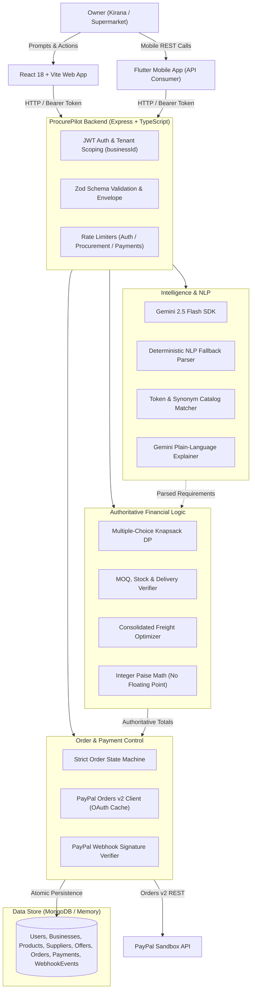
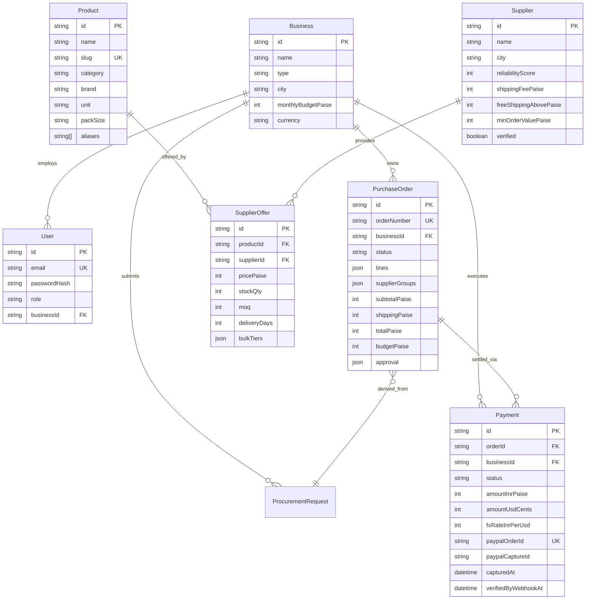
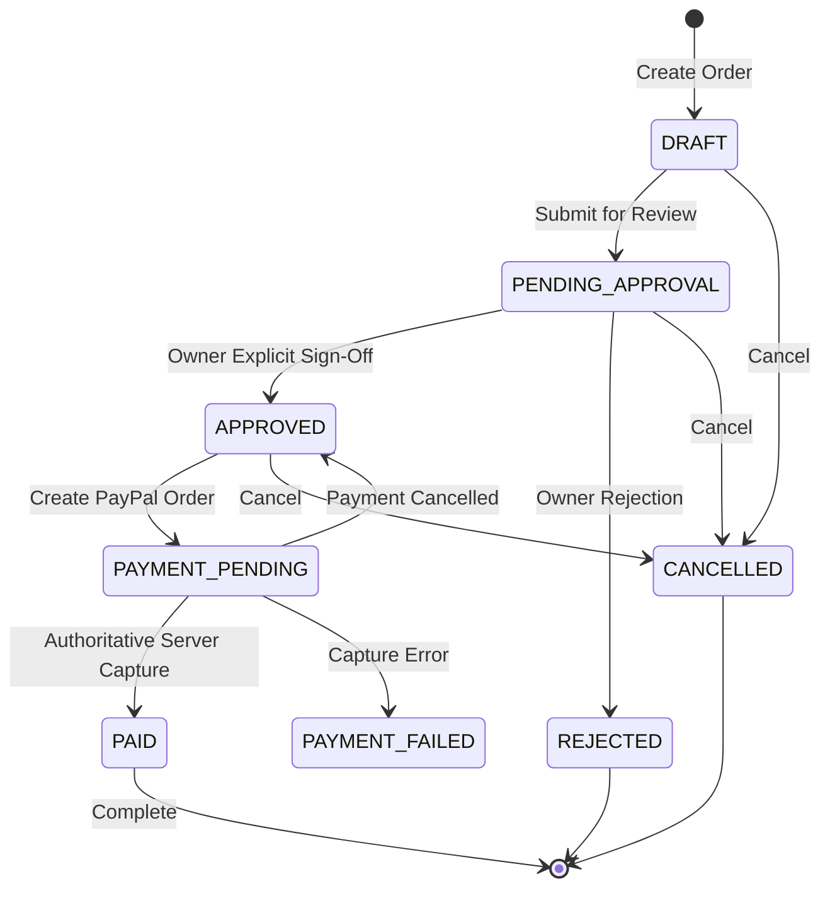

# ProcurePilot AI — System Architecture & Design

ProcurePilot AI is an autonomous procurement agent designed specifically for small retail businesses (kirana stores, supermarkets, cafes, and small offices). It translates natural language restocking requests into mathematically optimal purchase orders fulfilled by verified regional wholesale distributors and settled securely via PayPal Sandbox.

---

## 1. High-Level Architecture

The system enforces a strict boundary between probabilistic AI reasoning (Gemini 2.5 Flash) and deterministic financial logic (Node.js + MongoDB + PayPal Orders API v2).

---

## 2. Non-Negotiable Safety Principles

1. **Zero AI Financial Authority**:
   - AI **NEVER** moves money, computes totals, picks winning bids authoritatively, or marks anything paid.
   - AI is strictly limited to (a) parsing unstructured user text into structured JSON schemas, and (b) generating natural language explanations of the deterministically chosen plan.
   - All arithmetic (prices, minimum order quantities, freight, and currency conversion) runs strictly in pure TypeScript code.

2. **Never Trust Frontend Numbers**:
   - The backend recomputes all line totals, shipping fees, and order amounts directly from the database at order creation, again at payment creation, and again before PayPal capture verification.
   - Any discrepancy between requested amounts and calculated database amounts immediately rejects the request (`400 PAYMENT_ERROR`).

3. **Mandatory Owner Approval**:
   - PayPal Sandbox order creation is blocked by the order state machine unless the purchase order is in `APPROVED` status with an explicit timestamp and owner ID.

4. **Cryptographic Webhook Verification**:
   - Incoming PayPal webhooks are checked against PayPal's `v1/notifications/verify-webhook-signature` API using the webhook transmission ID, timestamp, and certificate URL.
   - Events are deduplicated idempotently via `WebhookEvent` unique indexes.

5. **Multi-Tenant Isolation**:
   - Every database query for orders, businesses, payments, and procurement requests is explicitly scoped by `req.businessId`.
   - Access to a resource belonging to another business produces `404 NOT_FOUND` (preventing tenant enumeration).

---

## 3. Data Model & Entity Relationships

---

## 4. Integer Money Model

To prevent IEEE 754 floating-point inaccuracies, floating point arithmetic is banned from storage and calculations:
- **Domestic Currency (INR)**: Stored as integer `paise` ($1\text{ INR} = 100\text{ paise}$).
  - Example: `₹15,000` is represented as `1500000` paise.
- **PayPal Payment Currency (USD)**: Stored as integer `cents` ($1\text{ USD} = 100\text{ cents}$).
  - PayPal Sandbox does not accept INR transactions. The backend converts INR paise to USD cents using a configured fixed demo rate (`DEMO_INR_PER_USD`, default `88`).
  - Conversion formula:
    $$\text{amountUsdCents} = \text{round}\left(\frac{\text{amountInrPaise}}{\text{fxRate} \times 100}\right) \times 100$$
  - Every PayPal purchase unit breakdown is strictly balanced so that `item_total` matches the authoritative total cents.

---

## 5. Order State Machine

### State Transition Invariants
- Only `APPROVED` orders may transition to `PAYMENT_PENDING`.
- Capture verification transitions `PAYMENT_PENDING` $\to$ `PAID`.
- Incoming PayPal webhooks update `verifiedByWebhookAt` and confirm the `PAID` state.

---

## 6. Optimization Engine: Multiple-Choice Knapsack

When an owner requests items across a budget limit:
1. **Candidate Offer Retrieval**: For each item in the requirement list, all active wholesale offers satisfying MOQ and stock requirements are retrieved.
2. **Strategy Scoring**: Offers are evaluated using deterministic strategy weights:
   - `cheapest`: 90% price, 5% reliability, 5% speed.
   - `reliable`: 65% reliability, 20% price, 15% speed.
   - `balanced`: 40% price, 35% reliability, 25% speed.
   - `fastest`: 60% speed, 25% reliability, 15% price.
3. **Consolidation Bonus**: Suppliers carrying multiple required items receive a preference bonus to minimize split freight charges.
4. **Knapsack DP**: If total spend exceeds the user's budget ceiling, a dynamic programming knapsack solver selects the optimal subset maximizing satisfaction score within the budget limit.

---

## 7. Assumptions & System Constraints

1. **PayPal INR Limitation**: PayPal Sandbox does not permit INR transaction currency. ProcurePilot honestly models this in the UI and backend: ledger records are maintained in integer paise (INR), converted to USD cents at ₹88/USD for PayPal Sandbox checkout.
2. **Honest Fulfillment Model**: A single PayPal transaction cannot split funds automatically across 7 unlinked supplier bank accounts. ProcurePilot acts as the procurement broker: the owner pays ProcurePilot's merchant sandbox account once; the Purchase Order creates distinct supplier sub-orders for regional wholesale fulfillment.
3. **Embedded MongoDB Memory Server**: For portable evaluation without external database setup, the backend boots with an embedded `MongoMemoryServer` fallback if `MONGODB_URI` is not set or unreachable.
