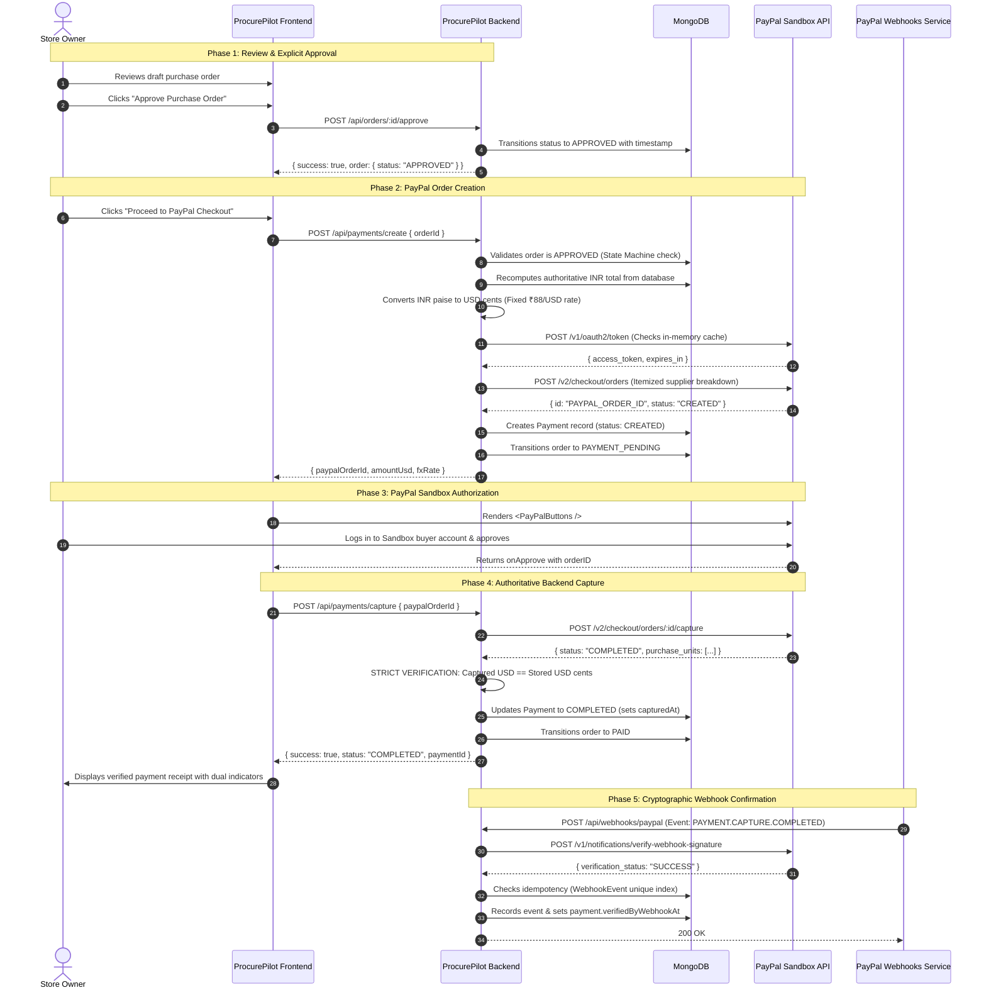

# ProcurePilot AI — PayPal Orders API v2 Payment Flow

This document details the end-to-end payment and settlement flow for ProcurePilot AI, utilizing PayPal Orders API v2 with strict deterministic verification, multi-vendor fulfillment modeling, and cryptographic webhook verification.

---

## 1. End-to-End Payment Sequence



---

## 2. Currency Conversion & Exact Cent Matching

### Known Limitations Addressed
- **PayPal does not support INR** as a payment currency.
- All internal transactions, catalogue prices, and financial accounting are stored in **integer paise (INR)**.
- For PayPal Sandbox checkout, amounts are converted to USD using a configurable demo conversion rate:
  ```env
  DEMO_INR_PER_USD=88
  ```

### Breakdown Cent Matching Invariant
In PayPal Orders API v2, `amount.breakdown.item_total` **must exactly equal** `amount.value`. If rounding errors produce an off-by-one discrepancy (e.g., sum of supplier items is `$142.04` but order total is `$142.05`), PayPal rejects the request with `422 UNPROCESSABLE_ENTITY`.

ProcurePilot resolves this deterministically:
1. Each supplier fulfillment group is converted to USD cents:
   $$\text{groupCents} = \text{round}\left(\frac{\text{groupSubtotalPaise} + \text{groupShippingPaise}}{88}\right)$$
2. The total USD cents sent to PayPal is set to the exact sum of these group cents:
   $$\text{amountUsdCents} = \sum \text{groupCents}$$
3. Stored payment records capture the exact rate, converted USD cents, and original INR paise.

---

## 3. Mandatory Security & Fraud Controls

| Control | Mechanism | Failure Action |
| :--- | :--- | :--- |
| **Tamper Protection** | Backend never accepts totals from frontend; recalculates from DB | `400 VALIDATION_ERROR` |
| **State Machine Guard** | Order must be `APPROVED` before `/payments/create` can execute | `400 INVALID_STATE` |
| **Capture Verification** | Backend validates captured USD matches stored order value within \$0.01 | `400 PAYMENT_ERROR` |
| **Idempotent Payment** | Active `CREATED` payment for an order returns existing PayPal order ID | Returns cached record |
| **Webhook Signature** | Checked via `verify-webhook-signature` against PayPal API | `400 WEBHOOK_VERIFICATION_FAILED` |
| **Webhook Dedup** | Stored in `WebhookEvent` collection with unique index on `eventId` | Ignores duplicates (200 OK) |

---

## 4. Local Webhook Testing Guide

### Option A: Using ngrok
To receive real PayPal Sandbox webhooks on your local development machine:

1. Start your local ProcurePilot backend:
   ```bash
   cd backend
   npm run dev
   ```
2. Start an ngrok tunnel to port 5000:
   ```bash
   ngrok http 5000
   ```
3. Copy the HTTPS forwarding URL (e.g., `https://abc1234.ngrok-free.app`).
4. In your [PayPal Developer Dashboard](https://developer.paypal.com/dashboard/applications/sandbox):
   - Under your Sandbox App, click **Add Webhook**.
   - Set the URL to: `https://abc1234.ngrok-free.app/api/webhooks/paypal`.
   - Subscribe to events: `PAYMENT.CAPTURE.COMPLETED`, `CHECKOUT.ORDER.APPROVED`.
   - Copy the generated **Webhook ID** and place it in `backend/.env`:
     ```env
     PAYPAL_WEBHOOK_ID=your_webhook_id_here
     ```

### Option B: Automated Integration Test
ProcurePilot includes automated mock tests that verify cryptographic webhook signature validation and deduplication without requiring an external ngrok tunnel:
```bash
cd backend
npm run test tests/webhooks.test.ts
```
All signature checks and duplicate event rejection pass with 100% deterministic assertion.
